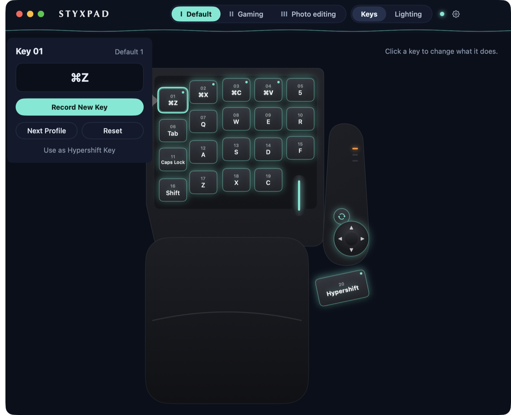
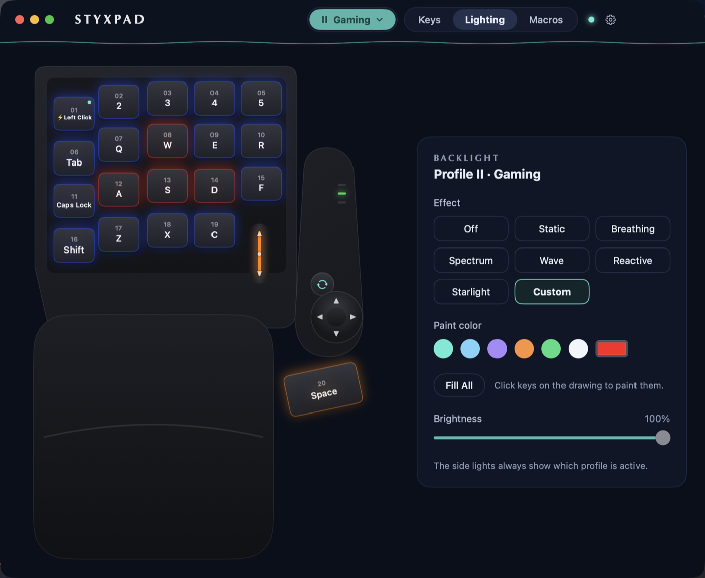
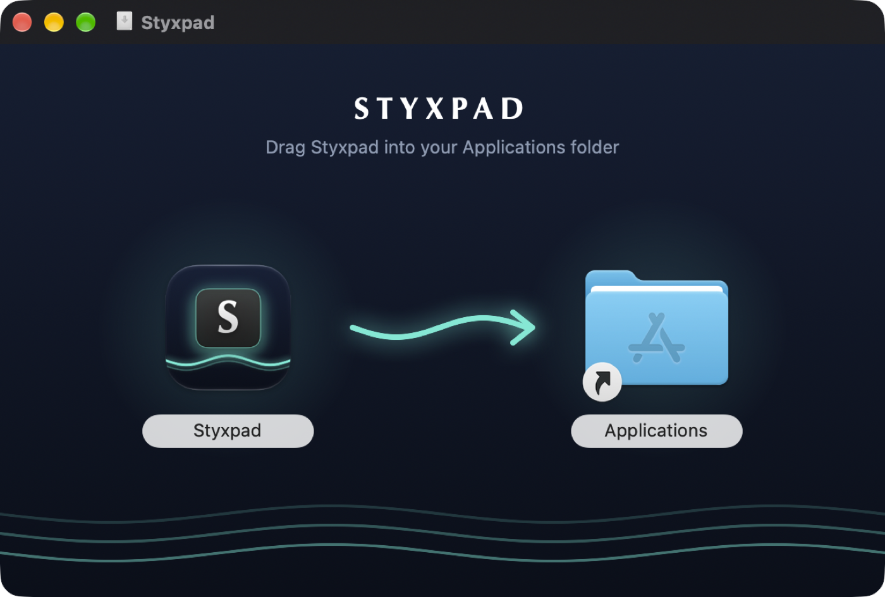

# Styxpad

*Key remapping for Razer Tartarus keypads on macOS.*

Razer Synapse doesn't run on the Mac, so out of the box a Tartarus Pro only types its factory
keys. Styxpad lets you remap every key, record macros, set up three profiles, and control the lighting.



## Features

- **Remap any key** to another key or a shortcut (e.g. ⌘Z). Click a key on the drawing of your
  Tartarus, press what it should type — done.
- **More than keys:** mouse clicks, scrolling, media keys (play/pause, volume, mute), opening an
  app or website, typing a saved phrase, or switching a key off.
- **Macros:** record a sequence of keys on your keyboard, then play it from any Tartarus key —
  once, over and over while the key is held, or on and off like a switch.
- **Turbo:** a held key repeats 5, 10 or 20 times a second.
- **Hypershift:** hold a key of your choice to give every other key a second function.
- **3 profiles**, one per side light. The Side button switches profiles and the side lights
  show which one is active.
- **Profiles that follow your apps:** link apps to a profile and Styxpad switches to it whenever
  one of them is in front, then switches back when you leave.
- **Import and export** profiles to back them up or share them.
- **Backlight effects per profile:** static, breathing, spectrum, wave, reactive and starlight,
  with colors, speed and brightness — previewed live on screen. The lights turn off while your
  Mac is asleep or locked.



## Install

1. Download **Styxpad-0.2.dmg** from the [Releases page](https://github.com/EvenDog/Styxpad/releases/latest).
2. Open it and drag **Styxpad** into **Applications**.
3. Open Styxpad. The welcome screen walks you through two permissions macOS requires:
   - **Input Monitoring** — so Styxpad can read your Tartarus's key presses.
   - **Accessibility** — so Styxpad can type your remapped keys.

Styxpad lives in the menu bar (the **[S]** keycap icon). Remaps work while it's running; turn on
**Open Styxpad at login** in Settings to have it always on.



**Requirements:** macOS 14 or later, Apple Silicon or Intel. Tested with the **Razer Tartarus Pro**;
other Tartarus models may work for remapping but are untested.

## Good to know

- Styxpad doesn't install any drivers. It mutes the Tartarus's own keys using Apple's built-in
  per-device key remapping, and gives them back when Styxpad quits.
- If the Tartarus's keys ever stop working after Styxpad crashes, unplug it and plug it back in.
- Updating from 0.1: once you've used 0.2's new actions or macros, don't go back to 0.1. It can't
  read them and starts over with a blank profile.
- Not supported (yet): remapping the scroll wheel, per-key colors, analog actuation settings.

## Build from source

You need Xcode (for Swift and its command-line tools).

```bash
./build-app.sh             # builds build/Styxpad.app
open build/Styxpad.app
```

`./make-release.sh` builds the signed, notarized DMG (it needs a Developer ID certificate and
notarization credentials — see the comments at the top of the script).

### How it works

1. `TartarusDevice.swift` finds the Tartarus over USB and listens to its keys. It mutes the
   Tartarus's own keys with Apple's `hidutil` (for that device only; undone when the app quits).
2. `Remapper.swift` looks up each press in the active profile and types the replacement, or runs
   its action: a click, a media key, a macro (`Macro.swift`), Turbo, and so on.
3. `MainWindow.swift` is the window: click a key on the drawing (`DeviceView.swift`) and a
   popover lets you record what it should type; the Lighting tab edits the backlight, and the
   Macros tab (`MacrosScreen.swift`) records macros.
4. `RazerProtocol.swift` builds the lighting commands (side lights and backlight effects).
5. `AppProfileLinker.swift` switches profiles when you switch apps.
6. `Theme.swift` holds the "Styx" colors and fonts.

Profiles and macros are saved in `~/Library/Application Support/Styxpad/profiles.json`.

## Credits

The lighting commands use Razer's undocumented protocol, implemented from public research by the
[OpenRazer](https://github.com/openrazer/openrazer) and CommandPost projects.

## License

MIT — see [LICENSE](LICENSE).

Styxpad is an independent project and is not affiliated with or endorsed by Razer Inc.
"Razer" and "Tartarus" are trademarks of Razer Inc.
